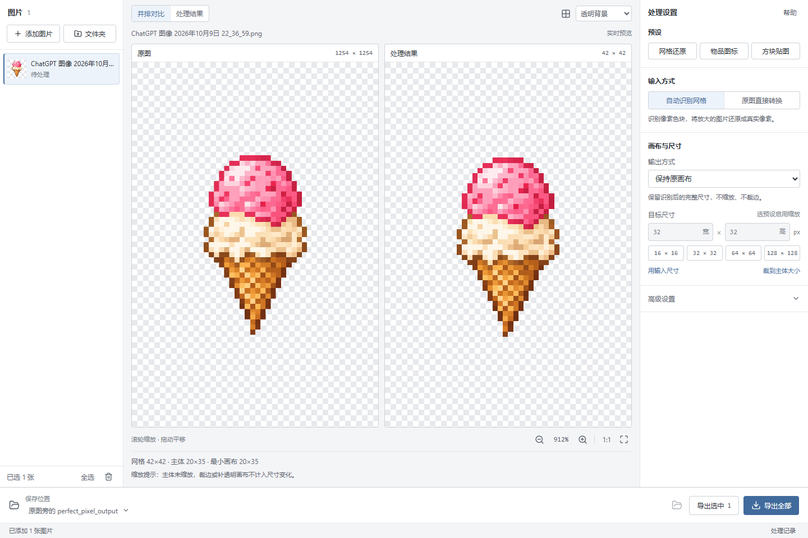
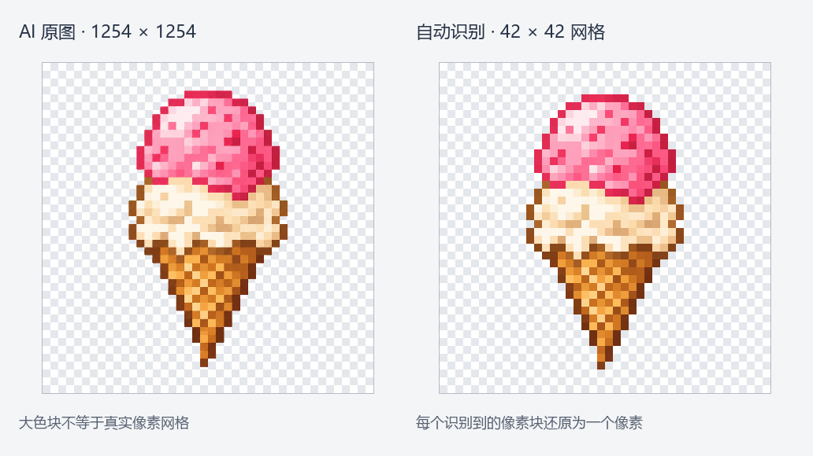
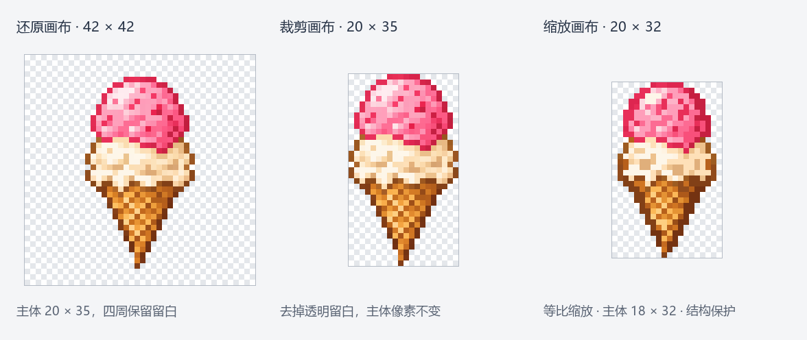
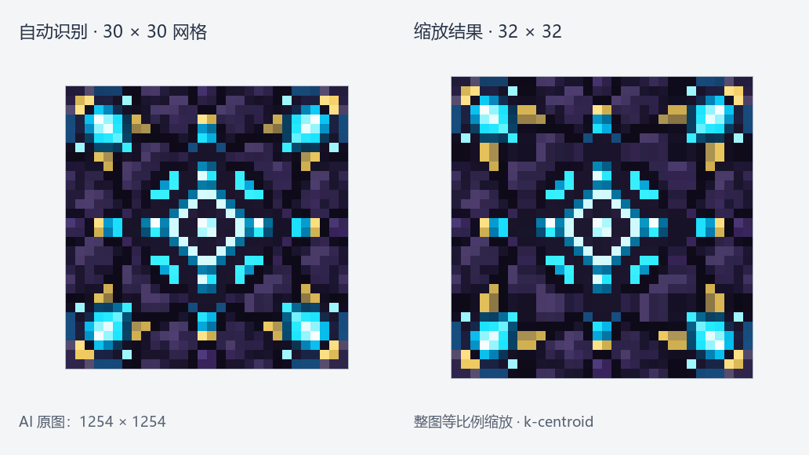

# Pixel Regrid

将 AI 生成的伪像素画还原为规则像素网格，并提供像素缩放、画布调整和批量导出。
图片在本机处理。

[在线使用](https://mmm-2006.github.io/Pixel-Regrid/) · [下载桌面版](https://github.com/mmm-2006/Pixel-Regrid/releases)

## 功能

- 自动识别像素网格，清理不均匀色块与模糊边缘。
- 最近邻、结构保护、k-centroid 三种缩放算法。
- 主体裁边、等比例缩放、透明画布调整，支持 16×16、32×32 等尺寸。
- 原图与结果并排预览、像素网格、批量导出。

## 效果示例

自动识别 AI 图片中的像素块数，将冰淇淋原图还原为 **42×42** 的规则像素网格。
网格化后可以继续缩放主体、裁剪或调整画布。

冰淇淋主体为 **20×35**：裁剪画布可去掉透明留白、保留主体像素；
使用目标像素算法（64 色、细节保护关闭）等比例缩放到 **20×32** 画布时，主体为 **18×32**。

附魔台顶面识别为 **30×30** 网格，再使用 **k-centroid** 放大为 **32×32** 贴图。

以上均为 JavaScript 版实际处理结果，展示时按最近邻放大。

## 使用

网页版直接打开 [Pixel Regrid](https://mmm-2006.github.io/Pixel-Regrid/)，添加或拖入图片即可使用，无需安装。
图片在浏览器本地处理，不会上传；单张导出 PNG，多张打包 ZIP。GIF 仅处理静态帧。

桌面版支持 Windows x64，需要 [WebView2 Runtime](https://developer.microsoft.com/en-us/microsoft-edge/webview2/)。
JavaScript 桌面包无需安装 Python 或 Node.js。

1. 从 [Releases](https://github.com/mmm-2006/Pixel-Regrid/releases) 下载 Windows EXE，双击运行。
2. 添加图片，选择自动识别网格，按需调整缩放算法和画布尺寸。
3. 检查预览后导出。结果另存为 PNG，原图保留。

详细操作见 [使用说明](docs/使用说明.txt)。自动识别效果取决于原图网格，必要时可使用“原图直接转换”。

## 开发

仓库保留 JavaScript/Tauri 和 Python 两套实现。
源码运行、构建与测试见 [开发指南](docs/DEVELOPMENT.md)，算法差异见 [对照报告](docs/JAVASCRIPT_EVALUATION.md)。

## 致谢

- [perfectPixel](https://github.com/theamusing/perfectPixel)：网格识别与还原算法。
- [pixeldetector](https://github.com/Astropulse/pixeldetector)：k-centroid 缩放参考。
- [Real-PixelArt](https://github.com/Bocchi-The-Glock/Real-PixelArt)：JavaScript/Tauri 轻量化桌面方案参考。

## 许可证

原创代码与自制示例采用 [MIT](LICENSE) 许可证。第三方来源与许可见 [THIRD_PARTY_NOTICES.md](THIRD_PARTY_NOTICES.md)。
桌面 EXE 内置许可原文，可在“帮助 → 许可与第三方声明”查看。
